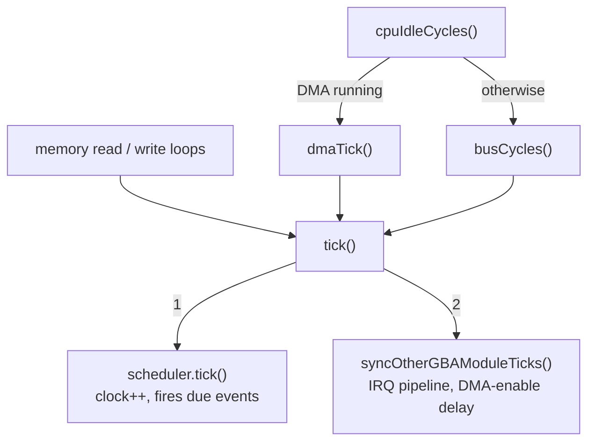
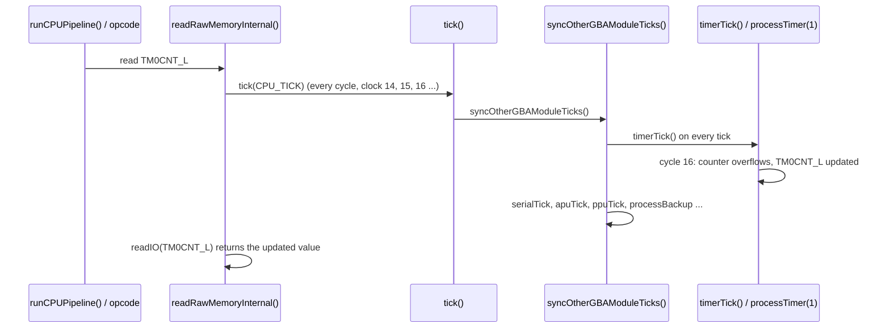
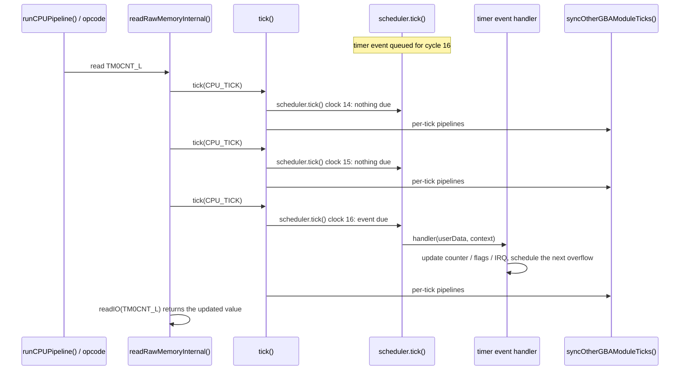

# GBA event scheduler: notes

The GBA core isn't reaching 60 fps consistently, so timing moves to a scheduler. Only the GBA core uses it; the other cores stay as they are.

---

## 1. Tick path

Every kind of ticking (CPU access cycles, `cpuIdleCycles()`, `busCycles()`, DMA) ends in the GBA `tick()`. That is the one place the scheduler is called from, so the clock advances and due events fire inside the cycle, before the CPU's next read.



`scheduler.tick()` runs first, so an IRQ raised by an event is latched by the pipeline in the same tick.

- `cpuIdleCycles()`: the CPU's internal cycles, called from the ARM7TDMI opcodes and interrupt handlers. Calls `dmaTick()` if DMA is running, otherwise `busCycles()`.
- `busCycles()`: one CPU tick. Also used for HALT<->UNHALT transitions and for HALT when DMA isn't running.
- `dmaTick()`: DMA processing. Called from `cpuIdleCycles()` and HALT when DMA is running, and from the memory read/write functions when the CPU accesses the bus while DMA is running.
- Memory read/write loops: one tick per CPU access cycle, and one DMA tick per DMA access cycle.
- Free bus cycles: when a DMA runs on a CPU idle cycle, the CPU's following idle cycles don't tick, because the DMA time is already counted (`freeBusCyclesCounter`).

## 2. Scheduler design

- **Global clock:** a 64-bit unsigned integer (`uint64_t`) tracking total master cycles, owned by the scheduler.
- **Priority queue and determinism:** events are sorted by target timestamp, then by a priority value, then by insertion order, so the execution order is the same when several events land on the same cycle.
- **Event types:** the scheduler is generic, so it doesn't define any. Each module registers its own event types at startup (`register_event`) and gets an `EventId` back, together with a handler and a priority for the same-cycle order.
- **Event payload:** an `EventId` and an integer context (e.g. timer 0, timer 1), passed to the registered handler `void (*)(void* userData, int context)`.

## 3. Public API

```cpp
EventId  register_event(EventHandler handler, void* userData, uint8_t priority = 0);   // called once per event type at startup
void     reset();                                       // clears the event queue and resets the master cycle counter to zero
uint64_t get_current_cycles() const;                    // current global master cycle count
uint64_t peek_next_timestamp() const;                   // target time of the next queued event
void     schedule(EventId id, uint64_t target_cycle, int context = 0);        // inserts a new event
void     cancel(EventId id, int context = 0);                                 // removes a pending event
void     reschedule(EventId id, uint64_t new_target_cycle, int context = 0);  // updates an active event's trigger time in place
void     tick();                                        // called every cycle: advances the clock by one and fires the due events
```

`tick()` is the only call needed per cycle. Advancing the clock and checking whether an event is due are private inline helpers behind it; popping the due events and calling their handlers happens only when something is due.

## 4. Initialization workflow

- **Manual reset:** hardware components (CPU, PPU, timers, etc.) are manually reset to their power-on states before the emulation loop starts (no need to schedule startup events).
- **Registration:** each module registers its event types.
- **Bootstrapping:** initial recurring events (such as the first scanline or timer ticks) are pre-scheduled into the queue, after which the main execution loop takes over.

## 5. Call sequences

### Current method (polling every cycle)

`tick()` calls `syncOtherGBAModuleTicks()` on every cycle, which does:

1. `timerTick()`, `serialTick()`, `apuTick()`, `ppuTick()`, `processBackup()`
2. the IRQ pipeline, the DMA-enable startup delay and the pending timer registers

The first five are called on every cycle and mostly have nothing to do.

### Proposed method (scheduler)

`tick()` calls `scheduler.tick()`, which increments the clock and, if an event is due, pops it and calls its registered handler. `tick()` then calls `syncOtherGBAModuleTicks()` for the pipelines that stay per tick. A module is only touched on the cycle it has work.

### Example: a timer event due at cycle 16

| Step | Clock | Queue check | Result |
|---|---|---|---|
| Start | 13 | a timer event is queued for cycle 16 | the CPU has finished cycle 13 and is about to step |
| `tick()` | 14 | 14 < 16 | nothing due |
| `tick()` | 15 | 15 < 16 | nothing due |
| `tick()` | 16 | 16 >= 16, the event is due | the scheduler pops it and calls the timer handler. The timer register is updated on cycle 16, before the CPU's next step |
| `tick()` | 17 | nothing due | the CPU reads the timer register and gets the value updated on cycle 16 |
| `tick()` | 18 | nothing due | execution continues |

Today, `timerTick()` runs on every tick and happens to overflow on the right one:



With the scheduler, the timer is only touched on the cycle it has work:



## 6. Events

### Timers

Candidate events:

- timer overflow (context = timer 0 to 3)
- timer Control write (Start/Stop also comes under this.)
- timer Reload write

Idea: schedule the timer register write as an event 1 cycle later, which would replace `GBA_ENABLE_DELAYED_TIMER_REG` in scheduler mode.
